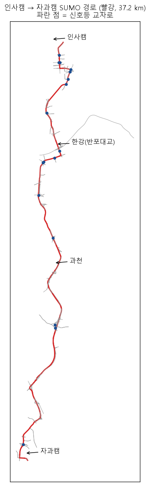

# 인사캠 → 자과캠 경로 (작업 중, skku-route 브랜치)

성균관대 인문사회과학캠퍼스에서 자연과학캠퍼스까지 이어지는 도로를 SUMO 도로망으로 만드는 작업이다. 아직 학습 환경(`env/road_config.py`)에는 연결하지 않았다.

## 현재 상태 (2026-11-09)

| 항목 | 값 |
|---|---|
| 경로 | 창경궁로 → 을지로 → 장충단로 → 녹사평대로 → 반포대로(반포대교) → 동작대로 → 과천대로 → 봉담과천로 → 경수대로 → 서부로 → 일월로 |
| SUMO 경로 길이 | 37.2 km (도로 179개) |
| 신호 교차로 | 10곳 |
| 차로 수 / 제한속도 | 1–11차로 / 50–100 km/h |

## 파일

- `skku_route_osrm.json`: OSRM 최단 경로 (39.7 km). 실제 셔틀 노선과 같은지는 확인하지 않았다.
- `skku_route_roads.osm`: 경로 주변 80 m 이내의 도로 (motorway–tertiary, 829개 way)
- `skku_route_map.png`: 위 지도

## 남은 일

1. `road_config.py`에 OSM 도로로 연결한다. netconvert 옵션은 `--tls.guess-signals --tls.discard-simple --tls.join --roundabouts.guess --keep-edges.components 1`이다.
2. 신호등을 처리한다. 지금 ego는 speedMode 0이라 빨간불을 무시한다.
3. 37 km 전체에 배경 교통을 넣는다.
4. 구간을 나눠서 학습한다 (무작위 출발점).
5. 자과캠 통학 셔틀 시범운행 노선(강남·양재 ↔ 자과캠 등)의 실제 경로를 확인해서 노선을 정한다.

지도 데이터: © OpenStreetMap contributors (ODbL)
